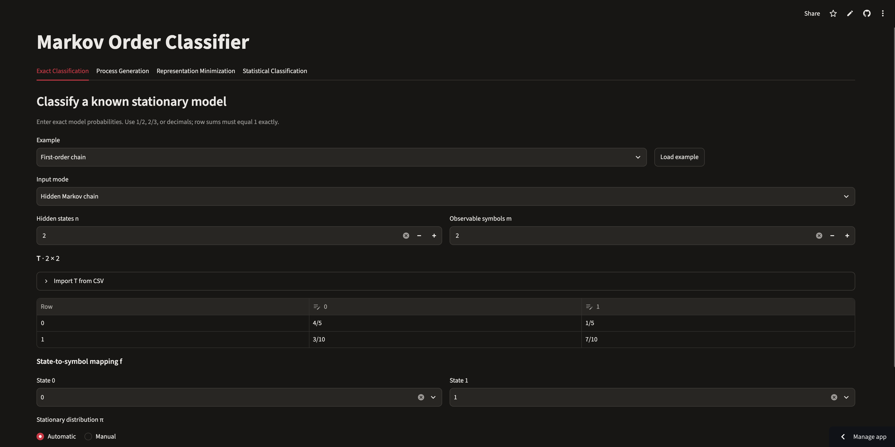

# Markov-Order Classifier

How much of the past does a stochastic process need to predict its next symbol? This project combines exact Markov-order classification of known stationary models with BIC-based estimation from observed sequences. It includes process generators, higher-block and symbolic representations, exact representation minimization, and reproducible experiments on finite- and infinite-memory processes. A Streamlit app brings the models, calculations, and results together in an interactive interface.

**[Try the live app](https://markov-order-classifier.streamlit.app/) · [Read the report (PDF)](moc_report.pdf) · [Explore the experiments](notebooks/statistical_experiments.ipynb)**

## Headline result

**BIC recovered the true order in 100% of runs for every tested finite order (0–5) at 10,000 symbols.** Each order used six fixed transition tables and 60 independent sequences per length. This is an empirical result for the sampled models, not a guarantee for every process; weak dependence can require substantially more data. See the [saved recovery rates](data/statistical_experiments/recovery_accuracy.csv) and [experiment notebook](notebooks/statistical_experiments.ipynb).



## Run locally

With Python 3 installed, run these commands from the repository directory:

```sh
python3 -m venv .venv
source .venv/bin/activate
pip install -r requirements.txt
streamlit run app.py
```

## Tests

With the same environment activated, run the unit and Streamlit integration tests:

```sh
python -m unittest discover -s tests
```
